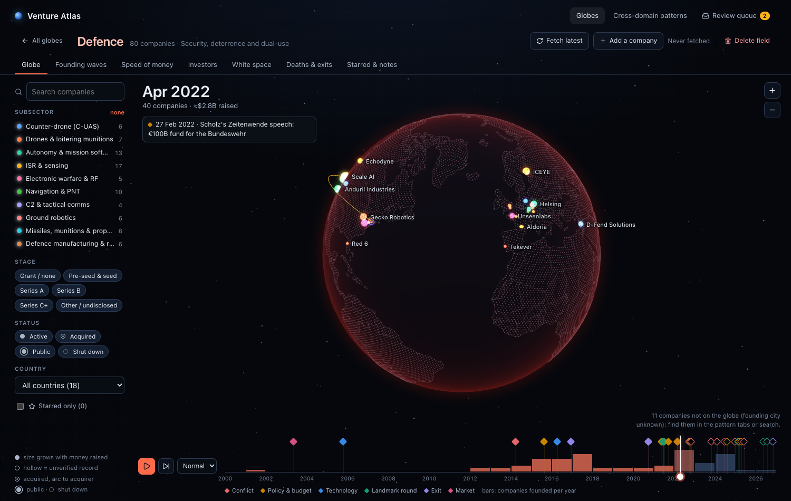

# Venture Atlas

A local, open-source tracker of who is raising what, where, and why it worked — shown as one globe per technology field.

Pick a field, press play, and watch its companies appear at their founding place and date, grow as they raise, and change when they are acquired, go public or shut down. Every funding figure links to the page that states it, and nothing reaches the atlas without being checked against that page.




## Quick start

You need [Node.js](https://nodejs.org) 20.12 or newer.

```bash
git clone <this repo> venture-atlas
cd venture-atlas
npm install
npm run dev
```

Open http://localhost:5173. That is all: the atlas ships with 265 companies, 691 funding rounds and 96 timeline events across six fields, and runs entirely on your machine. No account, no database, no key.

A key is only needed for the two buttons that research the web, **Fetch latest** and **Add a company** (next section).

## Connect an AI provider

Copy `.env.example` to `.env`, fill in one provider, restart.

| Provider | What to set |
|---|---|
| Claude (Anthropic) | `ANTHROPIC_API_KEY` |
| OpenAI | `OPENAI_API_KEY`, `ATLAS_MODEL` |
| Google Gemini | `GEMINI_API_KEY`, `ATLAS_MODEL` |
| DeepSeek | `DEEPSEEK_API_KEY` |
| OpenRouter, Mistral, Groq | their key, `ATLAS_MODEL` |
| Anything OpenAI-compatible (Ollama, LM Studio, a company gateway) | `ATLAS_BASE_URL`, `ATLAS_MODEL`, optionally `ATLAS_API_KEY` |
| Claude Code CLI | nothing: if it is installed and logged in, it is used when no key is set |

`ATLAS_MODEL` must be a model that supports tool calling. The server prints which provider it picked at startup, and the review-queue page shows it too.

Claude uses Anthropic's hosted web search. Every other provider searches through this server, which works without a key (DuckDuckGo) but is rate-limited; for regular use add a `TAVILY_API_KEY`, `BRAVE_API_KEY` or `SERPER_API_KEY`.

Your `.env` is git-ignored and never leaves your machine, except as the API calls you configure.

## How the data stays honest

The model is never trusted to report facts. Its output is treated as a list of claims, and each claim has to survive four checks:

1. **The server fetches the cited page itself.** What the model says a page contains is ignored; only text this server downloaded counts.
2. **Aggregators and social sites are refused** as sources (Crunchbase, PitchBook, LinkedIn and the like). Accepted evidence is, in order: the company's own announcement, an investor or official release, reputable press, Wikipedia.
3. **A second, independent model call** sees only the claim and the page text. It must return a verdict and a verbatim quote from the page.
4. **Code checks the checker.** The quote must appear on the page character for character, the amount must appear on the page in a written form ("€25 million", "25M", "25,000,000"), and the page must mention the company. A "confirmed" that fails any of these is not accepted.

Each fact ends up in one of four states:

| State | What happens |
|---|---|
| Confirmed | Kept and marked with a green tick |
| Corrected | Rewritten from what the page says, then marked |
| Unsupported | Removed |
| Not confirmed (page unreachable, or a check failed) | Kept, flagged, and the record waits for you |

Records whose every fact is confirmed are added to the atlas straight away. Anything else lands in the **review queue**, where you see each claim, the verdict, the reason and the quote before you approve or reject. Set `ATLAS_AUTO_APPROVE=off` to review everything.

Unknown values are stored as `null` and shown as "unknown". Nothing is estimated.

The seed data went through the same idea at scale: all 1,074 sourced facts and 96 events were re-checked against their pages by an independent pass. The results, every correction and every removal are in [`data/verification/REPORT.md`](data/verification/REPORT.md).

### What "confirmed" does not mean

- **It does not mean complete.** The check proves that what is recorded is on the page. It cannot find a round nobody recorded, and early rounds are the usual gap, so totals are lower bounds for many companies.
- **Narrative fields are not fact-checked:** story, wedge, founder backgrounds, competitor lists and the "why it mattered" line on events are the researcher's reading of the sources.
- **Totals across currencies** ("≈$…") use fixed indicative rates and are for comparison only. Dossiers show amounts as the source reports them.

## Add or remove a field

Each globe is a field, and fields are data, not code.

- **Add:** on the home page, press **Add a field**. Choose one from the list (fields already on your atlas are not offered) or pick "Custom field…" and name your own. Add a few keywords, press Save, and a new, empty globe appears. Press **Fetch latest** on it to research and verify its first companies.
- **Remove:** open a field and press **Delete field**. The dialog tells you how many companies and events will be deleted from disk. Companies that also belong to another field stay there.

The catalog of suggested fields is `data/field-catalog.json`; edit it freely.

## What you can do in the app

- **Home:** one slowly rotating globe per field, with companies tracked, how many are European, and money raised.
- **Field view:** scrub or play the timeline from 2000. Filter by subsector, stage, status and country. External events (wars, policy, technology releases, landmark rounds) are marked on the timeline so you can see what triggered each wave.
- **Dossier:** click a company for its story, founders, starting wedge versus what it became, every sourced round with time since founding, first customers, and its sources. Star it and keep notes.
- **Pattern tabs:** founding waves, speed of money, which investors lead first rounds and who arrived early, a subsector-by-region white-space matrix, and what killed or acquired whom. Also across all fields at once.

## Where things are

| Path | What |
|---|---|
| `data/companies/<field>.json` | Company records, one file per field, sorted by id so diffs stay readable |
| `data/events.json` | Timeline events |
| `data/taxonomy.json` | Your fields and their subsectors (set `"enabled": false` on a subsector to hide it) |
| `data/field-catalog.json` | Fields offered in "Add a field" |
| `data/schema/` | JSON Schemas for companies and events |
| `data/verification/` | Verification report and the raw verdicts with supporting quotes |
| `server/` | API, AI providers (`providers.mjs`), web access (`web.mjs`), verification (`verify.mjs`), research pipeline |
| `src/` | React app; `src/globe/engine.ts` renders every globe in one WebGL canvas |

Local-only and git-ignored: `.env`, your stars and notes (`data/user/`), the review queue (`data/queue/`).

## Commands

```bash
npm run dev        # API + app on http://localhost:5173 (PORT=5174 npm run dev for another port)
npm test           # verification logic, providers (against a mock), URL safety, data integrity
npm run validate   # check every data file against the schemas
npm run build && npm start   # production build served by the same server
```

## Safety notes

- The server listens on `127.0.0.1` only.
- The page fetcher refuses local and private addresses, so a model cannot be steered into reading services on your network.
- Research runs can only search and read the web. They cannot write files; the server validates what comes back and writes it itself.

## Licence

MIT. Company data is compiled from public sources, each linked from the record that uses it.
