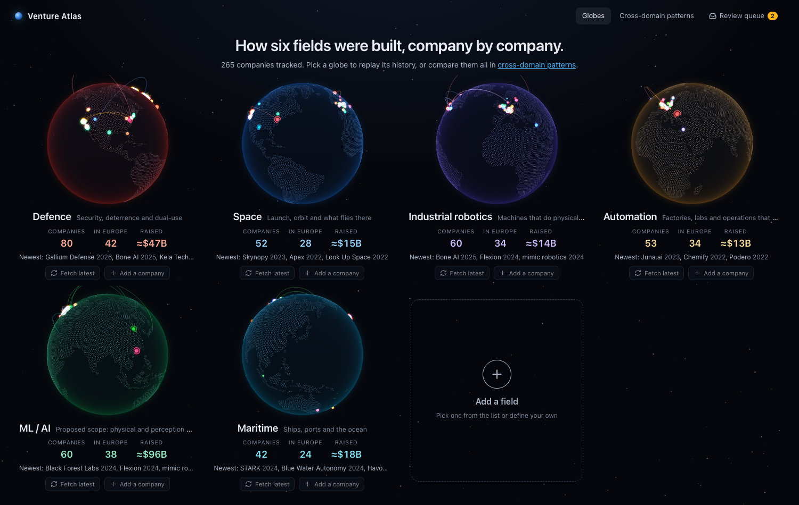

# Venture Atlas

A local, open-source tracker of who is raising what, where, and why it worked — shown as one globe per technology field.

Pick a field, press play, and watch its companies appear at their founding place and date, grow as they raise, and change when they are acquired, go public or shut down. Every funding figure links to the page that states it, and nothing reaches the atlas without being checked against that page.




## Quick start

You need [Node.js](https://nodejs.org) 22.12 or newer (24 LTS recommended).

> **Tested on:** a MacBook (macOS, Chrome and Safari) and an iPhone (installed from Safari, over Tailscale). It is written to work the same on Windows and Linux laptops, Android phones and a Raspberry Pi with a 64-bit OS, but those have not been tried yet. If something breaks there, please open an issue.

```bash
git clone <this repo> venture-atlas
cd venture-atlas
npm install
npm run dev
```

Open http://localhost:5173. That is all: the atlas ships with 265 companies, 691 funding rounds and 96 timeline events across six fields, and runs entirely on your machine. No account, no database, no key.

A key is only needed for the two buttons that research the web, **Fetch latest** and **Add a company** (next section).

## Phone app

The atlas installs on a phone (iPhone or Android) as an app, straight from the browser, with no app store. Tested on iPhone; Android should work the same but has not been tried yet.

- **With no connection at all** it opens and shows the data built into it, or the last data it fetched from one of your servers.
- **When one of your machines is running the atlas and the phone is on Tailscale**, it uses that machine: live data, your stars and notes, the review queue, and "Fetch latest" / "Add a company". Research runs on that machine with its keys; nothing secret is on the phone.

It tries the server that opened the page first, then your saved servers in order (say the Raspberry Pi, then the laptop), and uses the first that answers. It checks again each time you bring the app back to the front.

### 1. Make a machine reachable (laptop, Raspberry Pi…)

On each machine that should serve the phone, with [Tailscale](https://tailscale.com/download) installed and logged in:

```bash
npm install
npm run build
npm start                    # keep it running (on Linux/RPi: see deploy/venture-atlas.service)
tailscale serve --bg 5173    # once; remembered across restarts
```

`tailscale serve` prints an address like `https://my-laptop.tail1234.ts.net`. It is HTTPS with a real certificate, reachable only from devices on your tailnet. The first time, Tailscale may ask you to enable **MagicDNS** and **HTTPS certificates** in its admin console.

The server itself still listens on `127.0.0.1` only; Tailscale forwards to it.

### A Raspberry Pi (or any Linux box) as an always-on server

The atlas does not need your laptop (this setup is untested so far; it was written for, but not yet run on, a Pi): a Raspberry Pi 4 or 5 (2 GB+, **64-bit** Raspberry Pi OS) or a small cloud VM with Tailscale works on its own. On it:

```bash
git clone https://github.com/antoinehinary/venture-atlas.git && cd venture-atlas
bash deploy/setup-linux.sh
```

The script checks Node.js and Tailscale, builds the app, installs a systemd service that starts on boot and restarts after crashes, runs `tailscale serve`, and prints the address for your phone. Put an AI key in its `.env` (`ANTHROPIC_API_KEY` is simplest on a Pi) for research. Update later with `git pull && bash deploy/setup-linux.sh`.

If `tailscale serve` already publishes something else on port 443 of a machine, give the atlas its own port: `tailscale serve --bg --https=8443 5173`, then use `https://….ts.net:8443`.

### 2. Install the app on the phone

Install Tailscale on the phone and log in with the same account. Then open the app from either of:

- **GitHub Pages:** `https://<your-github-username>.github.io/venture-atlas/`. Works from anywhere. Deployed by `.github/workflows/pages.yml` on every push to `main` (one-time: repo Settings → Pages → Source: *GitHub Actions*). Add `ATLAS_APP_ORIGINS=https://<your-github-username>.github.io` to the `.env` of each server so it accepts calls from that page.
- **One of your servers:** its `https://….ts.net` address. Nothing public, but you need Tailscale on to install or update the app.

Then:

- **iPhone (Safari):** Share → **Add to Home Screen**.
- **Android (Chrome):** menu → **Install app** (or **Add to Home screen**). Chrome may ask to allow access to devices on your local network: allow it, that is your Tailscale server.

Open the app, tap the status dot (top right), and add each server's `https://….ts.net` address. A green dot means it answers.

Notes:

- Each machine keeps its own data. A star or a research run on the laptop does not appear on the Raspberry Pi. Pick one machine as the main one, or sync `data/` with git.
- Without a server, stars and notes are shown but read-only, so two copies never drift apart.
- iPhone home-screen *widgets* need a native app; this is an app icon that opens full screen.

## Connect an AI provider

Copy `.env.example` to `.env`, fill in one provider, restart.

| Provider | What to set |
|---|---|
| Claude (Anthropic) | `ANTHROPIC_API_KEY` |
| OpenAI | `OPENAI_API_KEY`, `ATLAS_MODEL` |
| Google Gemini | `GEMINI_API_KEY`, `ATLAS_MODEL` |
| DeepSeek | `DEEPSEEK_API_KEY` |
| OpenRouter, Mistral, Groq | their key, `ATLAS_MODEL` |
| Anything OpenAI-compatible (Ollama, LM Studio, a company gateway) | `ATLAS_BASE_URL`, `ATLAS_MODEL`, optionally `ATLAS_API_KEY` |
| Claude Code CLI | nothing: if it is installed and logged in, it is used when no key is set |

`ATLAS_MODEL` must be a model that supports tool calling. The server prints which provider it picked at startup, and the review-queue page shows it too.

Claude uses Anthropic's hosted web search. Every other provider searches through this server, which works without a key (DuckDuckGo) but is rate-limited; for regular use add a `TAVILY_API_KEY`, `BRAVE_API_KEY` or `SERPER_API_KEY`.

Your `.env` is git-ignored and never leaves your machine, except as the API calls you configure.

## How the data stays honest

The model is never trusted to report facts. Its output is treated as a list of claims, and each claim has to survive four checks:

1. **The server fetches the cited page itself.** What the model says a page contains is ignored; only text this server downloaded counts.
2. **Aggregators and social sites are refused** as sources (Crunchbase, PitchBook, LinkedIn and the like). Accepted evidence is, in order: the company's own announcement, an investor or official release, reputable press, Wikipedia.
3. **A second, independent model call** sees only the claim and the page text. It must return a verdict and a verbatim quote from the page.
4. **Code checks the checker.** The quote must appear on the page character for character, the amount must appear on the page in a written form ("€25 million", "25M", "25,000,000"), and the page must mention the company. A "confirmed" that fails any of these is not accepted.

Each fact ends up in one of four states:

| State | What happens |
|---|---|
| Confirmed | Kept and marked with a green tick |
| Corrected | Rewritten from what the page says, then marked |
| Unsupported | Removed |
| Not confirmed (page unreachable, or a check failed) | Kept, flagged, and the record waits for you |

Records whose every fact is confirmed are added to the atlas straight away. Anything else lands in the **review queue**, where you see each claim, the verdict, the reason and the quote before you approve or reject. Set `ATLAS_AUTO_APPROVE=off` to review everything.

Unknown values are stored as `null` and shown as "unknown". Nothing is estimated.

The seed data went through the same idea at scale: all 1,074 sourced facts and 96 events were re-checked against their pages by an independent pass. The results, every correction and every removal are in [`data/verification/REPORT.md`](data/verification/REPORT.md).

### What "confirmed" does not mean

- **It does not mean complete.** The check proves that what is recorded is on the page. It cannot find a round nobody recorded, and early rounds are the usual gap, so totals are lower bounds for many companies.
- **Narrative fields are not fact-checked:** story, wedge, founder backgrounds, competitor lists and the "why it mattered" line on events are the researcher's reading of the sources.
- **Totals across currencies** ("≈$…") use fixed indicative rates and are for comparison only. Dossiers show amounts as the source reports them.

## Add or remove a field

Each globe is a field, and fields are data, not code.

- **Add:** on the home page, press **Add a field**. Choose one from the list (fields already on your atlas are not offered) or pick "Custom field…" and name your own. Add a few keywords, press Save, and a new, empty globe appears. Press **Fetch latest** on it to research and verify its first companies.
- **Remove:** open a field and press **Delete field**. The dialog tells you how many companies and events will be deleted from disk. Companies that also belong to another field stay there.

The catalog of suggested fields is `data/field-catalog.json`; edit it freely.

## What you can do in the app

- **Home:** one slowly rotating globe per field, with companies tracked, how many are European, and money raised.
- **Field view:** scrub or play the timeline from 2000. Filter by subsector, stage, status and country. External events (wars, policy, technology releases, landmark rounds) are marked on the timeline so you can see what triggered each wave.
- **Dossier:** click a company for its story, founders, starting wedge versus what it became, every sourced round with time since founding, first customers, and its sources. Star it and keep notes.
- **Pattern tabs:** founding waves, speed of money, which investors lead first rounds and who arrived early, a subsector-by-region white-space matrix, and what killed or acquired whom. Also across all fields at once.

## Where things are

| Path | What |
|---|---|
| `data/companies/<field>.json` | Company records, one file per field, sorted by id so diffs stay readable |
| `data/events.json` | Timeline events |
| `data/taxonomy.json` | Your fields and their subsectors (set `"enabled": false` on a subsector to hide it) |
| `data/field-catalog.json` | Fields offered in "Add a field" |
| `data/schema/` | JSON Schemas for companies and events |
| `data/verification/` | Verification report and the raw verdicts with supporting quotes |
| `server/` | API, AI providers (`providers.mjs`), web access (`web.mjs`), verification (`verify.mjs`), research pipeline |
| `src/` | React app; `src/globe/engine.ts` renders every globe in one WebGL canvas; `src/lib/api.ts` finds a server or falls back to offline data |
| `public/` | Phone-app files: manifest, icons, `sw.js` (offline support) |
| `deploy/` | systemd service for Linux and Raspberry Pi |

Local-only and git-ignored: `.env`, your stars and notes (`data/user/`), the review queue (`data/queue/`).

## Commands

```bash
npm run dev        # API + app on http://localhost:5173
npm test           # verification logic, providers (against a mock), URL safety, data integrity
npm run validate   # check every data file against the schemas
npm run build && npm start   # production build served by the same server (use this for the phone app)
npm run icons      # re-render the app icons in public/ (needs Chrome, Edge, Brave or Chromium)
```

Another port: `PORT=5174 npm run dev` on macOS and Linux, `$env:PORT=5174; npm run dev` in Windows PowerShell, or `PORT=5174` in `.env` anywhere.

On Windows, if you use the Claude Code CLI as the AI provider and it is not found, set `CLAUDE_BIN` in `.env` to the full path of `claude.exe` (or `claude.cmd`).

## Safety notes

- The server listens on `127.0.0.1` only. Other devices reach it only through `tailscale serve`, so only your tailnet can.
- Browsers may call it from another address only if that address is on the same tailnet as the server, or listed in `ATLAS_APP_ORIGINS` (`server/origins.mjs`).
- The page fetcher refuses local and private addresses, so a model cannot be steered into reading services on your network.
- Research runs can only search and read the web. They cannot write files; the server validates what comes back and writes it itself.

## Licence

MIT. Company data is compiled from public sources, each linked from the record that uses it.
